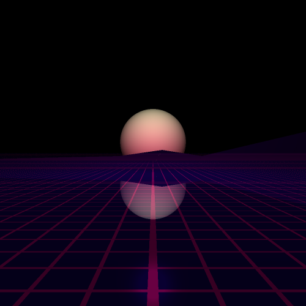
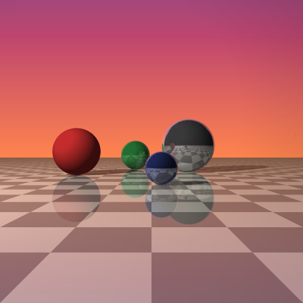

# Lightweight ray tracer

[](https://github.com/alex-aparin/RayTracer/actions/workflows/ci.yml)

A portable, tiny-footprint ray tracer written in C, based on the Phong reflection model.

| Demo scene (`scenes/demo.c`) | Chess balls scene (`scenes/chess_balls.c`) |
| --- | --- |
|  |  |

## Features

- **Phong lighting** — diffuse and specular components, clamped to `[0, 1]`
- **Three light types** — ambient, point and directed lights, each with shadows (shadow rays are cast toward the light source)
- **Recursive reflections** — materials can be reflective; reflected color is blended with the local color (`lerp_color`) up to a fixed recursion depth
- **3x3 supersampling antialiasing** — each pixel averages 9 sub-pixel rays, smoothing edges and reflections
- **Intersections** — sphere, plane and arbitrary convex polygon (via the even-odd rule with a projection plane)
- **Extensible scene graph** — objects and lights are vtables (`graphic_object`, `light_object`), so new primitives and light types can be added without touching the tracer core
- **No dependencies** beyond the C standard library and `libm`

## Project layout

```
include/ray_tracer.h       Public API: math helpers, primitives, lights, scene, trace()
include/objects.h          Generic object constructors (uniform sphere, plane)
src/ray_tracer.c           Core: vector/color math, intersection tests, lighting, recursive tracing
src/objects/sphere.c       Generic sphere object (uniform color, specularity, reflectivity)
src/objects/plane.c        Generic plane object
scenes/demo.h/.c           Demo scene: gradient sphere, checkered plane, polygon mountains
scenes/chess_balls.h/.c    Sunset scene: mirror balls on a checkerboard floor
tools/ppm_file_generator/  Example app: renders all scenes and writes PPM images
CMakeLists.txt             Build: core lib + demo scene lib + tool executables
```

## API overview

The entry point is `trace()`:

```c
void trace(scene_t* scene, int canvas_width, int canvas_height, put_pixel_callback put_pixel);
```

The tracer walks every pixel, casts a ray from the origin through the viewport and reports the resulting color through your `put_pixel` callback — so the core is fully independent of any windowing or image library. The caller owns the scene and passes it in:

```c
scene_t scene;
demo_scene_init(&scene);
trace(&scene, width, height, put_pixel_func);
demo_scene_destroy(&scene);
```

The project is layered into three pieces:

- **Core** (`libray_tracer`) — `src/ray_tracer.c` plus generic primitives in `src/objects/` (`create_sphere_object`, `create_plane_object` from `include/objects.h`). Knows nothing about any concrete scene.
- **Scenes** (`libdemo_scene`, `libchess_balls_scene`) — a scene is just an array of `graphic_object`/`light_object` vtables filled in by an init function. Add your own scene by writing an analogous `init`/`destroy` pair.
- **Tools** — executables like `tools/ppm_file_generator` link the core and whichever scene(s) they need.

Geometry/material primitives used by the API:

- `world_point` / `world_vector` — 3D vectors (`float coords[3]`)
- `color_t` — RGB color (`unsigned char channels[3]`)
- `material_t` — color, normal, specularity (`-1` disables the specular term), reflectivity in `[0, 1]`
- `world_sphere`, `world_plane`, `world_line` — primitives for intersection tests

## Building

The build is driven by CMake (no dependencies besides a C compiler and `libm`):

```sh
cmake -S . -B build -DCMAKE_BUILD_TYPE=Release
cmake --build build
```

This produces a `ray_tracer` static library and the `ppm_file_generator` executable (a ready-made `main.c` that calls `trace()` and writes plain-text `P3` PPM files). It renders every scene into its own image:

```sh
./build/ppm_file_generator   # writes demo_scene.ppm and chess_balls_scene.ppm (500x500 each)
```

To use the tracer in your own app, link against the `ray_tracer` target and pass your own `put_pixel` callback to `trace()`.

## Tests

```sh
ctest --test-dir build --output-on-failure
```

The smoke test (`tests/smoke_test.c`) covers vector math, quadratic solving and sphere intersection, then renders both scenes into a small buffer and checks the output is non-empty and deterministic.

## License

[MIT](LICENSE)
